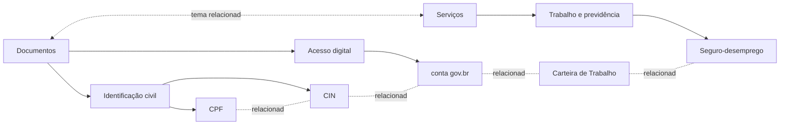

# FIAP - Faculdade de Informática e Administração Paulista

<!-- Se o projeto ficar dentro do repositório-modelo FIAP-PORTFOLIO, ajuste o caminho do logo:
<p align="center"></p> -->

<br>

# Citizen Assist AI — Global Solution 2026.2 (CitizenTech)

## Nome do grupo

**[NOME DA EQUIPE]**

## 👨‍🎓 Integrantes

| Nome | RM |
|---|---|
| [Nome do integrante 1](link do LinkedIn ou GitHub) | RM00000 |
| [Nome do integrante 2] | RM00000 |

## 👩‍🏫 Professores

### Tutor(a)
- [Nome do tutor]

### Coordenador(a)
- <a href="https://www.linkedin.com/in/andregodoichiovato/">André Godoi Chiovato</a>

## 🎥 Vídeo de apresentação

**[Link do vídeo no YouTube (não listado)](COLE_O_LINK_AQUI)**

---

## 📜 1. O problema e o público

Quem precisa tirar um documento, pedir um benefício ou entender um direito costuma encontrar informações espalhadas por vários sites, com termos difíceis e instruções incompletas. O **Citizen Assist AI** é um assistente de orientação cidadã, em modo texto, que:

- recebe uma pergunta escrita do jeito que a pessoa fala ("fui mandado embora, como recebo o seguro?") ou a escolha de um tema no menu;
- encontra a orientação certa numa **base verificada em fontes oficiais**;
- responde em linguagem simples, com passo a passo, **fonte, link e data em que a fonte foi conferida**;
- avisa quando é preciso confirmar no canal oficial e **diz claramente quando não sabe**, em vez de inventar.

**Público beneficiado:** cidadãos em geral, especialmente quem tem pouca familiaridade com os portais do governo (pessoas idosas, quem está tirando o primeiro documento, trabalhadores recém-demitidos, famílias de baixa renda).

**Temas abordados (23 orientações em 4 temas e 15 subtemas):**

| Tema | Orientações |
|---|---|
| Documentos | CIN (novo RG), CPF, Carteira de Trabalho Digital, título de eleitor, passaporte, certidão de nascimento, conta gov.br |
| Serviços de saúde e assistência | cartão do SUS, Farmácia Popular, vacinação, CadÚnico, seguro-desemprego, Meu INSS |
| Direitos do cidadão | arrependimento em compras on-line, reclamar de empresa, Juizado Especial, Defensoria Pública, prioridade à pessoa idosa, meia-entrada, LGPD |
| Orientações comunitárias e canais de ajuda | Disque 100, Ligue 180, SAMU 192 |

> ⚠️ Protótipo acadêmico. **Não é canal oficial** de nenhum órgão público e não substitui o atendimento oficial.

## 📁 Estrutura de pastas

```text
citizen-assist-ai/
├── data/
│   ├── base_conhecimento.json        base de orientações (editável)
│   ├── perguntas_teste.json          54 perguntas de teste e resposta esperada
│   ├── resultados_testes.csv         registro gerado pela avaliação
│   ├── resultados_testes_v1_antes_ajustes.csv   1ª rodada (histórico)
│   └── comparacao_modelos.csv        critérios por resposta (modelo A x B)
├── docs/
│   ├── resultados_testes.md          relatório de testes (gerado)
│   ├── resultados_testes_v1_antes_ajustes.md
│   ├── modelos_de_prompt.md          os dois modelos de instrução e a comparação
│   ├── grafo_assuntos.md             diagrama do grafo de assuntos (Mermaid)
│   ├── teste_usabilidade.md          roteiro e resultados do teste com usuário
│   └── uso_ia.md                     uso de IA e validação crítica
├── src/
│   ├── sistema.py                    programa principal (menu)
│   ├── base_conhecimento.py          leitura e validação da base
│   ├── busca.py                      normalização, índice invertido e ranking
│   ├── navegacao.py                  hierarquia e grafo de assuntos
│   ├── respostas.py                  modelos de resposta (prompts A e B)
│   ├── avaliacao.py                  testes automáticos e indicadores
│   └── usabilidade.py                roteiro do teste de facilidade de uso
└── tests/
    └── test_sistema.py               17 testes de robustez (unittest)
```

## 🗂️ 2. Base de conhecimento, estruturas e estratégia de busca

### 2.1 Organização da base (`data/base_conhecimento.json`)

Cada orientação é um objeto JSON com os campos:

| Campo | Obrigatório | Para que serve |
|---|---|---|
| `id` | sim | identificador único (ex.: `DOC01`); prefixo indica o tema |
| `tema`, `subtema` | sim | posição na hierarquia (precisam existir em `temas`) |
| `titulo` | sim | nome curto mostrado nos menus |
| `pergunta` | sim | pergunta típica que a orientação responde |
| `palavras_chave` | sim | termos e expressões que as pessoas usam (inclusive populares, como "rg novo") |
| `orientacao` | sim | resumo em linguagem simples |
| `referencia` | sim | `orgao`, `titulo` e `url` da fonte oficial |
| `data_verificacao` | sim | data (AAAA-MM-DD) em que a fonte foi conferida |
| `passos` | não | passo a passo numerado |
| `requer_confirmacao` | não | `true` quando o dado varia (por estado, município) ou muda com frequência (taxas, prazos) |
| `observacao_confirmacao` | não | motivo da confirmação, mostrado no aviso |
| `relacionados` | não | ids de orientações ligadas (arestas do grafo) |

O arquivo também guarda o dicionário de `temas` (com `subtemas`), os `temas_relacionados` e um dicionário de `sinonimos` (ex.: `"avo": ["idoso"]`, `"remedio": ["medicamento"]`).

**Origem das orientações:** todas foram resumidas de páginas oficiais (gov.br, Planalto, Polícia Federal, TSE, Ministério da Saúde, Consumidor.gov.br) e os links foram abertos em **19/11/2026**. Leis (CDC, Estatuto da Pessoa Idosa, LGPD, Lei dos Juizados, Lei da Meia-Entrada) foram citadas pelo artigo.

**Manutenção sem mexer no código:** para acrescentar ou corrigir uma orientação basta editar o JSON. Ao iniciar, `base_conhecimento.py` valida tudo:

- arquivo ausente, vazio ou JSON inválido → mensagem clara (com linha e coluna do erro) e o programa encerra sem travar;
- registro sem campo obrigatório, com id repetido, tema/subtema inexistente, URL inválida ou data em formato errado → o registro é **ignorado** e o motivo é mostrado; os demais continuam funcionando;
- `relacionados` apontando para id inexistente → ligação removida com aviso;
- fonte verificada há mais de 365 dias → aviso para revisar.

Conferir a base: `python src/sistema.py --validar`.

### 2.2 Estruturas de dados

| Estrutura | Tipo | Uso |
|---|---|---|
| `base.registros` | lista de dicionários | todas as orientações, na ordem do arquivo |
| `base.por_id` | dicionário `id → registro` | consulta por identificador em tempo constante |
| `base.por_tema` | dicionário `tema → subtema → [ids]` | hierarquia de 3 níveis para o menu |
| `motor.indice` | dicionário `palavra → {id: peso}` | **índice invertido** usado pela busca |
| `motor.sinonimos` | dicionário `palavra → conjunto` | expansão da consulta |
| `grafo.adjacencia` | dicionário `nó → [(vizinho, tipo)]` | **grafo** de temas, subtemas e orientações (lista de adjacência) |

### 2.3 Hierarquia e grafo de assuntos

Os assuntos formam uma **árvore** (tema → subtema → orientação) e, por cima dela, um **grafo** com dois tipos de aresta extra:

- **orientação ↔ orientação** (`relacionados`): assuntos que costumam vir juntos. Ex.: *CPF → CIN → conta gov.br → Carteira de Trabalho → seguro-desemprego → INSS*. A justificativa é a dependência real entre serviços: a CIN usa o número do CPF; a Carteira de Trabalho Digital exige conta gov.br; o seguro-desemprego é pedido pelo app da Carteira de Trabalho, e assim por diante;
- **tema ↔ tema** (`temas_relacionados`): ex.: Documentos ↔ Serviços (os serviços pedem documentos), Direitos ↔ Canais de ajuda.

Depois de cada resposta o assistente faz uma **busca em largura (BFS)** a partir da orientação mostrada e oferece os 3 assuntos mais próximos em "PARA CONTINUAR", permitindo navegar de assunto em assunto (ex.: CPF → CIN → certidão de nascimento → cartão do SUS...). O diagrama completo está em [docs/grafo_assuntos.md](docs/grafo_assuntos.md).



### 2.4 Estratégia de busca (`src/busca.py`)

1. **Validação da entrada:** vazia → `ENTRADA_VAZIA`; só símbolos ou só palavras genéricas ("como faço?") → `ENTRADA_INVALIDA`; texto limitado a 300 caracteres.
2. **Privacidade:** CPF, e-mail e telefone são detectados por expressão regular e trocados por `[omitido]` antes da busca (e o usuário é avisado).
3. **Normalização:** minúsculas, sem acentos, sem pontuação.
4. **Remoção de *stopwords*:** artigos, preposições e verbos genéricos ("tirar", "fazer", "preciso") que não distinguem um assunto do outro.
5. **Radical simplificado:** corta plural, gênero e terminações verbais, para que *idosa/idoso*, *documentos/documento* e *denunciar/denúncia* virem a mesma chave.
6. **Expansão da consulta:** sinônimos da base (*avó → idoso*, *remédio → medicamento*) e correção de digitação com `difflib` (*pasaporte → passaporte*).
7. **Pontuação por índice invertido:** cada palavra da pergunta soma o peso do campo em que aparece no registro: palavra-chave e título = 3, pergunta = 2, nome do tema/subtema = 1. Uma palavra-chave composta encontrada inteira na pergunta (ex.: "seguro desemprego") ganha +2.
8. **Decisão:**
   - aceita o registro se tiver ≥ 3 pontos **e** cobrir ao menos 50% das palavras da pergunta **ou**, em perguntas longas, acertar 2+ palavras somando ≥ 6 pontos;
   - pergunta que pede **dado local ou do caso pessoal** (horário, endereço, valor exato, andamento do meu pedido) → não responde e explica o porquê;
   - nenhum registro aceito → `SEM_RESPOSTA`, com as correspondências parciais como "assuntos parecidos" e os temas sugeridos.

**Quando há várias correspondências:** os candidatos são ordenados por pontos (e, no empate, pela cobertura).

- Se o 2º colocado tiver **≥ 90% dos pontos** do 1º, a pergunta é tratada como **ambígua**: o assistente lista as opções e pede para a pessoa escolher, em vez de chutar;
- se a pergunta tiver **uma única palavra que aparece em 3 ou mais registros** (ex.: "documento", "benefício"), também é ambígua;
- caso contrário, mostra o 1º colocado; os outros candidatos fortes aparecem pela navegação.

Por que essa estratégia e não uma IA generativa? É **explicável** (dá para mostrar por que um registro venceu), **rápida** (cerca de 0,2 ms por consulta), **não inventa conteúdo** e usa só os conteúdos estudados (dicionários, listas, ordenação, algoritmos de busca).

## 💬 3. Regras de resposta, prompts e limitações

| Situação | O que o assistente faz |
|---|---|
| Orientação encontrada | Mostra resposta, passo a passo, **fonte com link e data de verificação**, aviso e assuntos para continuar |
| Orientação que varia ou muda (`requer_confirmacao`) | Aviso "Confirme os requisitos atualizados no canal oficial" + o motivo |
| Pergunta ambígua | Lista as opções e pede para escolher |
| Sem orientação na base | "Não encontrei... prefiro não responder", sugere assuntos parecidos e temas, indica o gov.br |
| Pede dado local/pessoal | Explica que não tem horários, endereços, valores exatos ou andamento de pedidos |
| Entrada vazia / opção inexistente | Mensagem explicando o que digitar e repete a pergunta |
| Dados pessoais digitados | Remove e avisa que não são necessários nem guardados |

**Dois modelos de instrução** (detalhes em [docs/modelos_de_prompt.md](docs/modelos_de_prompt.md)):

- **Modelo A – Direto:** papel + "cite a fonte";
- **Modelo B – Estruturado (adotado):** papel e o que o assistente *não* é, público, regras de linguagem simples, formato fixo (RESPOSTA, COMO FAZER, FONTE CONSULTADA, ATENÇÃO, PARA CONTINUAR), fonte com data, aviso, regra de recusa e de privacidade.

Na comparação automática sobre todas as respostas encontradas, o Modelo B atendeu 5 de 5 critérios (fonte, data, aviso, passos, continuidade) contra 1,5 do Modelo A, com formato 100% consistente (A: 50%). O custo é ser ~3× mais longo (178 × 57 palavras). Dá para alternar no menu (opção 4).

## 🧪 4. Plano de testes, indicadores e resultados

### 4.1 Plano

| Conjunto | Ids | Qtd. | O que testa |
|---|---|---|---|
| Dúvidas diretas | T01–T08 | 8 | pergunta com o nome do serviço |
| Reformulações | T09–T18 | 10 | gírias, sinônimos, erro de digitação |
| Fora dos temas | T19–T21 | 3 | assunto sem orientação na base |
| Limitações | T22–T27 | 6 | entrada vazia, ambígua, só símbolos, dado local, dado pessoal |
| Às cegas – lote 1 | T28–T42 | 15 | perguntas escritas por uma IA que só viu os **títulos** dos assuntos |
| Às cegas – lote 2 | T43–T54 | 12 | idem, escritas **depois** dos ajustes e rodadas uma única vez |

Rodar: `python src/sistema.py --testes` (ou opção 6 do menu). O script compara obtido × esperado, mede o tempo de cada consulta (média de 50 repetições) e gera `data/resultados_testes.csv` e [docs/resultados_testes.md](docs/resultados_testes.md). Os 17 testes de robustez do código rodam com `python -m unittest discover tests`.

### 4.2 Resultados (execução de 19/11/2026)

| Indicador | Valor |
|---|---|
| Perguntas testadas | 54 |
| **Taxa de acerto geral** | **92,6% (50/54)** |
| Acerto nas perguntas da equipe (T01–T27) | 100% (27/27) |
| Acerto às cegas – lote 1, antes dos ajustes | 60,0% (9/15) |
| Acerto às cegas – lote 1, depois dos ajustes | 93,3% (14/15) |
| **Acerto às cegas – lote 2 (sem ajustes)** | **75,0% (9/12)** |
| Tempo médio de consulta | ≈ 0,2 ms (pior caso ≈ 1 ms) |
| Modelo de resposta B × A (critérios de clareza) | 5,0 × 1,5 (de 5) |

### 4.3 Interpretação

- **100% nas perguntas da própria equipe não prova nada sozinho:** quem escreveu as perguntas conhecia as palavras-chave. Por isso foram usados os lotes às cegas.
- **A primeira rodada às cegas deu 60%** e mostrou três falhas: o radical não tratava verbos (*denunciar* ≠ *denúncia*), a regra de cobertura reprovava perguntas longas e informais ("comprei um tênis pela internet e não gostei...") e faltava vocabulário ("documento de viagem", "16 anos"). Ver [docs/resultados_testes_v1_antes_ajustes.md](docs/resultados_testes_v1_antes_ajustes.md).
- Depois dos ajustes o lote 1 foi a 93%, mas esse número também é otimista (o lote foi usado para ajustar). **A estimativa honesta é o lote 2: 75%**: 3 de cada 4 perguntas novas são respondidas corretamente de primeira.
- **Os erros do lote 2 são, em sua maioria, "seguros":** em 1 caso o assistente não respondeu, mas a orientação certa apareceu como 1ª sugestão (CPF); em 1 caso pediu esclarecimento (registro de imóvel em cartório). **Houve 1 erro grave:** "aposentadoria rural... meu pai tem 60 anos" foi respondido com "prioridade à pessoa idosa" porque "60 anos" é palavra-chave daquele registro. Mesmo assim a resposta mostra o título e a fonte, o que deixa claro para a pessoa que o assunto é outro.
- **Tempo:** cerca de 0,2 ms em média e ≈ 1 ms no pior caso; a busca não é gargalo. Com milhares de registros o índice invertido continua eficiente, porque só os registros que contêm as palavras da pergunta são pontuados.

### 4.4 Teste de facilidade de uso

Roteiro com 5 tarefas (pergunta livre, linguagem do dia a dia, navegação por menu, percepção do limite e navegação pelo grafo) em [docs/teste_usabilidade.md](docs/teste_usabilidade.md). O programa conduz o teste (`python src/sistema.py --usabilidade`), mede tempo, número de consultas, conclusão e dificuldade (1–5), e gera `docs/resultados_usabilidade.md`.

> **[Preencher após aplicar com pelo menos 1 participante: taxa de conclusão, tempo médio, dificuldade média e dificuldades observadas.]**

## ▶️ 5. Como executar

Pré-requisito: **Python 3.10 ou superior**. Não há bibliotecas externas (só a biblioteca padrão).

```bash
git clone <URL_DO_REPOSITORIO>
cd <pasta-do-projeto>
python src/sistema.py
```

Outros modos:

```bash
python src/sistema.py --pergunta "como tirar o passaporte"   # uma pergunta e sai
python src/sistema.py --modelo A                             # usa o modelo de resposta A
python src/sistema.py --testes                               # avaliação + indicadores
python src/sistema.py --validar                              # confere a base
python src/sistema.py --usabilidade                          # teste com usuário
python -m unittest discover tests -v                         # testes de robustez
```

Menu principal:

```text
MENU PRINCIPAL
  [1] Escolher um tema
  [2] Fazer uma pergunta
  [3] Consultar por código da orientação
  [4] Trocar modelo de resposta (atual: Modelo B - Estruturado)
  [5] Sobre, privacidade e limitações
  [6] Rodar testes e indicadores
  [7] Teste de facilidade de uso (roteiro)
  [0] Sair
```

## 💡 6. Exemplos

**Pergunta informal (reformulação):** `fui mandado embora, como recebo o seguro desemprego?`

```text
SER05 | Seguro-desemprego
Tema: Serviços de saúde e assistência > Trabalho e previdência
RESPOSTA
  Quem foi dispensado sem justa causa pode pedir o seguro-desemprego pelo
  aplicativo Carteira de Trabalho Digital ou pelo portal gov.br. (...)
COMO FAZER
  1. Guarde o Requerimento do Seguro-Desemprego entregue pela empresa.
  2. Faça o pedido pelo aplicativo Carteira de Trabalho Digital ou pelo gov.br.
  (...)
FONTE CONSULTADA
  Ministério do Trabalho e Emprego (gov.br) - Solicitar o Seguro-Desemprego
  https://www.gov.br/pt-br/servicos/solicitar-o-seguro-desemprego
  Verificada em 19/11/2026
ATENÇÃO
  Confirme os requisitos atualizados no canal oficial antes de ir. Há prazo
  para fazer o pedido depois da demissão e regras de carência; (...)
PARA CONTINUAR, VOCÊ TAMBÉM PODE CONSULTAR
  [1] DOC03 - Carteira de Trabalho Digital
  [2] SER06 - Serviços do INSS (Meu INSS)
  [3] SER04 - Cadastro Único (CadÚnico)
```

**Erro de digitação:** `pasaporte pra viajar` → orientação DOC05 (Passaporte comum).

**Pergunta ambígua:** `benefício`

```text
Sua pergunta pode se referir a mais de um assunto. Qual destes você procura?
  [1] SER04 - Cadastro Único (CadÚnico)
  [2] SER05 - Seguro-desemprego
  [3] SER06 - Serviços do INSS (Meu INSS)
```

**Fora da base:** `Qual a receita de bolo de cenoura?`

```text
Não encontrei na base uma orientação confiável para essa pergunta.
Para não passar uma informação errada, prefiro não responder.
Assuntos parecidos que existem na base:
  [1] DOC02 - Inscrição no CPF
  [2] SER02 - Farmácia Popular
Temas sugeridos: Documentos; Serviços de saúde e assistência.
Para outros assuntos, procure o portal oficial gov.br ou o órgão responsável.
```

O assistente recusa corretamente, mas as sugestões mostram uma limitação da busca por palavras: "receita" aparece em "Receita Federal" (CPF) e em "receita médica" (Farmácia Popular). É um caso de **palavra com mais de um sentido** (polissemia), que só uma busca que entende o contexto resolveria.

**Dado local:** `Qual o horário de funcionamento do posto de saúde do meu bairro?`

```text
Essa pergunta depende de informações locais ou do seu caso (horários,
endereços, valores exatos, andamento de pedidos), que este assistente não tem.
Para não passar uma informação errada, prefiro não responder.
Assuntos parecidos que existem na base:
  [1] SER03 - Vacinação pelo SUS
  [2] SER01 - Cartão Nacional de Saúde (cartão do SUS)
  [3] SER02 - Farmácia Popular
```

**Entradas inválidas:** Enter sem texto → "Você não digitou nenhuma pergunta..."; `???!!!` → "Não consegui entender a pergunta..."; opção `9` no menu → `A opção "9" não existe. Digite uma das opções mostradas.`

**Dado pessoal:** `meu cpf é 123.456.789-00, como faço a carteira de trabalho digital?` → avisa "sua pergunta parecia conter CPF... foi removido e não é guardado" e responde DOC03.

## ♿ 7. Clareza, acessibilidade, privacidade e informação não oficial

- **Clareza:** frases curtas, siglas explicadas ("CNS", "CIN"), passos numerados e seções sempre na mesma ordem.
- **Acessibilidade:** interface só de texto (funciona com leitor de tela e em qualquer terminal), sem emojis nem desenhos nas respostas, linhas de até 76 caracteres, navegação toda por números, aceita perguntas sem acento e com erro de digitação. O Modelo A oferece respostas curtas para quem prefere.
- **Privacidade:** o assistente não pede nenhum dado pessoal; CPF, e-mail e telefone digitados são removidos antes da busca; nenhuma pergunta é gravada no uso normal; o teste de usabilidade identifica participantes só por código (P1, P2).
- **Informação não oficial:** aviso na abertura, no "Sobre" e em todas as respostas; cada orientação mostra o órgão, o link e a data de verificação; dados que variam são marcados para confirmação; o assistente não promete atendimento nem integração com órgãos públicos.

## 🧠 Decisões técnicas

> - **Sem IA generativa em tempo de execução:** em orientação cidadã, resposta inventada pode prejudicar alguém; a busca por regras é verificável e explicável.
> - **JSON** para a base: legível, editável sem programar e com estrutura aninhada (referência, passos).
> - **Índice invertido com pesos** em vez de comparar a pergunta com todos os textos: rápido e fácil de justificar.
> - **Grafo como lista de adjacência** + BFS: forma simples de sugerir "próximos assuntos".
> - **Somente biblioteca padrão do Python:** roda em qualquer máquina, sem instalação.

## ✅ 8. Conclusões, limitações e melhorias

**Conclusões:** o protótipo cumpre o fluxo completo (pergunta → validação → busca → orientação com fonte → aviso → continuidade) e, mais importante, sabe dizer "não sei". A avaliação às cegas mostrou que o desempenho real em perguntas novas é de cerca de 75%, bem abaixo dos 100% do teste feito pela própria equipe: a lição mais valiosa do projeto foi que **o teste precisa ser independente de quem constrói o sistema**.

**Limitações:**

- busca por palavras, sem entender a intenção: "60 anos" puxou "prioridade ao idoso" numa pergunta sobre aposentadoria rural, e "receita" (de bolo) sugeriu Receita Federal e receita médica;
- 23 orientações apenas; o que estiver fora da base não é respondido;
- orientações nacionais; regras estaduais e municipais (documentos da CIN, horários de UBS) não são cobertas;
- as fontes mudam: a base depende de revisão periódica (o sistema avisa após 365 dias);
- avaliação com 54 perguntas e poucos usuários: as taxas têm margem de erro grande.

**Melhorias possíveis:**

1. **Ranking com TF-IDF** (dar menos peso a palavras que aparecem em muitos registros, como "anos" e "carteira") e exigir que a palavra principal da pergunta esteja no registro, para reduzir respostas erradas como a do caso "60 anos".
2. **Busca semântica com *embeddings*** como segunda etapa, sempre devolvendo um registro da base (sem gerar texto livre).
3. **Ampliar a base** com orientações estaduais e municipais e um campo de abrangência (UF/município).
4. **Aprender com o uso:** registrar (sem dados pessoais) as perguntas sem resposta para orientar quais orientações criar.
5. **Modo resumo** (só RESPOSTA e FONTE) e versão por voz ou WhatsApp para quem tem dificuldade com texto.

---

## 📋 Licença

<p xmlns:cc="http://creativecommons.org/ns#" xmlns:dct="http://purl.org/dc/terms/"><a property="dct:title" rel="cc:attributionURL" href="https://github.com/fiap-tutoria/FIAP-PORTFOLIO-AI">TEMPLATE - FIAP PORTFÓLIO AI</a> por <a rel="cc:attributionURL dct:creator" property="cc:attributionName" href="https://fiap.com.br">FIAP</a> está licenciado sobre <a href="http://creativecommons.org/licenses/by/4.0/?ref=chooser-v1" target="_blank" rel="license noopener noreferrer" style="display:inline-block;">Attribution 4.0 International</a>.</p>
