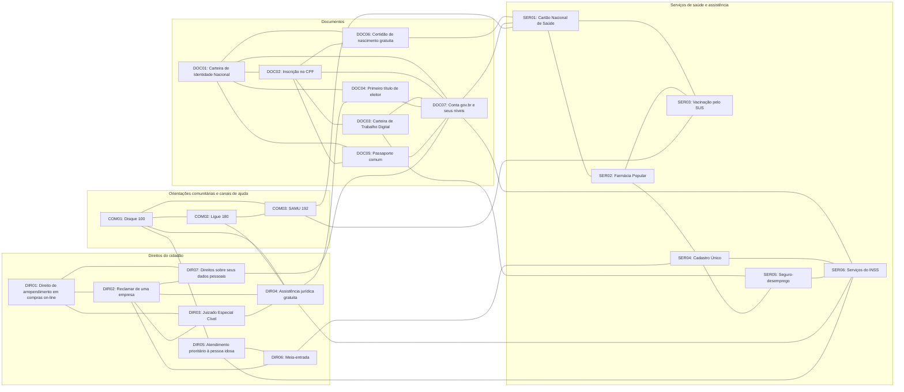

# Grafo de assuntos (gerado por `python src/sistema.py --grafo`)

Cada caixa é uma orientação, agrupada pelo tema. Cada linha liga duas orientações relacionadas (campo `relacionados` da base). É por essas ligações que o assistente sugere "PARA CONTINUAR".

